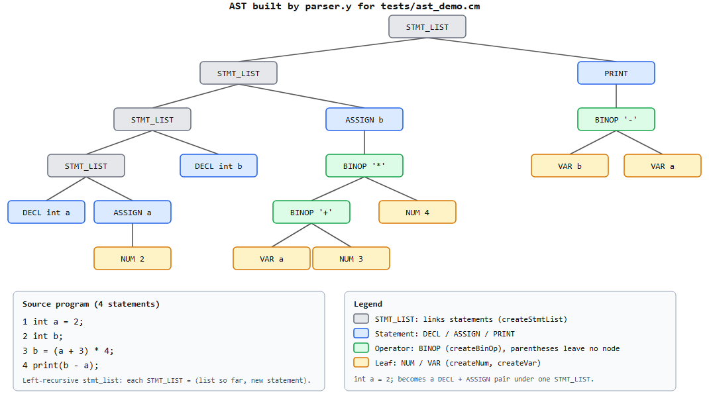

# CST-405 Project 2: Minimalist Language Compiler

**Author:** Alissa Head (worked alone, so every task below is mine)
**Course:** CST-405 Compiler Design, Topic 2 (Sep 14 – Oct 11, 2026)

This is a complete compiler for a very small C-like language. It takes a `.cm`
source file through six phases (scanning, parsing, semantic analysis,
three-address code, optimization and code generation) and writes MIPS assembly
that runs in SPIM / QtSPIM.

```
source.cm ──► scanner ──► parser ──► semantic ──► TAC ──► optimizer ──► codegen ──► peephole ──► source.s
             (tokens)     (AST)      (verdict)   (.tac)  (.optimized.tac)  (MIPS)               (file)
```

---

## 1. Quick start

Everything builds and runs on Linux. On Windows I use **WSL (Ubuntu 24.04)**.

```bash
sudo apt install flex bison gcc make spim     # one time

cd compiler
make                 # build ./minicompiler
make check           # unit tests + regression tests (all must PASS)

./minicompiler tests/ast_demo.cm out.s        # full trace of all six phases
./minicompiler tests/ast_demo.cm out.s -q     # quiet: errors + summary only
spim -file out.s                              # run the generated MIPS  ->  18
```

| Option    | Effect |
|-----------|--------|
| `-q`      | Quiet. Prints only errors and the final summary. |
| `-O0`     | Skips Phase 5 (TAC optimizer). The back end translates the raw TAC. |
| `-nopeep` | Skips the peephole pass over the generated MIPS. |

Each compile writes three files next to the `.s` file: `out.s`, `out.tac`
(the IR before optimization) and `out.optimized.tac` (the IR the back end
actually used). The exit status is **0** on success and **1** if any phase
reports an error.

---

## 2. The language

```c
// declarations (optionally with a value), assignment, + - *, parentheses, print
int a = 2;
int b;
b = (a + 3) * 4;
print(b - a);      /* prints 18 */
```

```
program     ->  stmt_list
stmt_list   ->  stmt  |  stmt_list stmt
stmt        ->  decl  |  assign  |  print_stmt
decl        ->  'int' ID ';'  |  'int' ID '=' expr ';'
assign      ->  ID '=' expr ';'
expr        ->  NUM  |  ID  |  expr '+' expr  |  expr '-' expr  |  expr '*' expr  |  '(' expr ')'
print_stmt  ->  'print' '(' expr ')' ';'
```

`*` binds tighter than `+` and `-`, and all three are left-associative.
Both comment styles, `// …` and `/* … */`, are supported.

---

## 3. The six phases: input, output, and how each works

| # | Phase | File(s) | Input | Output |
|---|-------|---------|-------|--------|
| 1 | Lexical analysis | `scanner.l` | characters | tokens (with line and column) |
| 2 | Syntax analysis | `parser.y`, `ast.c` | tokens | abstract syntax tree |
| 3 | Semantic analysis | `semantic.c`, `symtab.c` | AST | AST + pass/fail verdict |
| 4 | Intermediate code | `tac.c` | AST | three-address code (`.tac`) |
| 5 | Optimization | `tac.c` | TAC | smaller TAC (`.optimized.tac`) |
| 6 | Code generation | `codegen.c`, `peephole.c` | optimized TAC | MIPS assembly (`.s`) |

The driver, `main.c`, runs the phases in order and **stops at the first phase
that reports an error**, so nothing is generated for an incorrect program.

### Phase 1: Lexical analysis (`scanner.l`)
Flex turns the token rules into a finite automaton. Two rules decide every
ambiguity. **Longest match:** a closed comment beats the unterminated-comment
rule because it is one character longer. **First match:** the keyword rules
`int` and `print` sit above the identifier rule, so `int` is never scanned as
an `ID`.

*Errors:* an unknown character, or a `/*` comment that never closes, prints
`Lexical Error at line L, column C: …` on **stderr**. The scanner keeps going,
so every bad character in the file is reported in one run. It also counts the
errors, and the driver refuses to certify the program if the count is not zero.

### Phase 2: Syntax analysis and the AST (`parser.y`, `ast.c`)
Bison builds an LALR(1) parser. Every grammar rule has an action that builds
**one AST node** with a constructor from `ast.c` (`createDecl`, `createAssign`,
`createBinOp`, `createNum`, `createVar`, `createPrint`, `createStmtList`).

Design decisions:
- **Parentheses build no node.** The shape of the tree already records the
  grouping, which is what makes the tree *abstract*.
- **`int x = e;` is sugar** for a `DECL` followed by an `ASSIGN`, so no later
  phase needs a special case for it.
- **Error productions** name the mistake instead of printing "syntax error":
  `missing ';' after the assignment to 'x'`, `missing ')' to close the '(' after print`,
  `expected a value after '+'`. Each message carries the line and column where
  the missing token belonged, and shows the source line with a caret under
  that column.
- **Panic-mode recovery** (`error ';'`) skips to the next `;` and keeps
  parsing, so one compile reports *every* syntax error (see `t2_06`).

When there are no lexical or syntax errors, the driver prints
`✓ Parse succeeded — no lexical or syntax errors` and displays the AST:



### Phase 3: Semantic analysis (`semantic.c`, `symtab.c`)
This phase walks the AST with a scope stack and checks the rules the grammar
cannot express:

| Check | Example | Test |
|-------|---------|------|
| Use of an undeclared variable | `print(ghost);` | `t2_04`, `t2_14` |
| Duplicate declaration in the same scope | `int count; … int count;` | `t2_10` |
| Reserved names (`t0`, `t1`, …, `L0`, …) used as variables | `int t1;` | `t2_13` |

Each error is reported with its line number and a suggested fix. The analyzer
keeps going after an error, so all of them are reported. If there are none, it
prints `✓ Semantic analysis passed - program is semantically correct!`.

Reserved names are rejected because Phase 4 invents temporaries called `t0`,
`t1`, and so on. A user variable with one of those names would silently
collide with a temporary. (When this error fires, the name is still entered in
scope, so later uses don't produce a cascade of "undeclared" errors.)

The **symbol table** (`symtab.c`) maps every name to a storage location: four
bytes per `int`, at an offset from `$sp`, handed out in declaration order.
Phase 6 consults it whenever it loads or stores a variable.

### Phase 4: Three-address code (`tac.c`)
**How the AST becomes TAC.** `generateTACExpr` walks an expression tree
**post-order**, which is what makes it work: both operands are generated first,
then one instruction combines them into a fresh temporary, and the name of
that temporary is returned to the caller.

```
b = (a + 3) * 4          BINOP '*'                  t0 = a + 3
                          ├─ BINOP '+'      ──►     t1 = t0 * 4
                          │   ├─ VAR a              b  = t1
                          │   └─ NUM 3
                          └─ NUM 4
```

- A `NUM` or `VAR` leaf returns its own text. No instruction is needed.
- A `BINOP` emits `t = left op right` and returns `t`.
- Statements consume the returned name: `ASSIGN` emits `x = t`, `PRINT`
  emits `PRINT t`, and `DECL` emits `DECL int x` so the back end can reserve
  a slot for it.
- Temporaries are **recycled**: once an operand has been used, its temporary
  goes back on a free list (`allocTemp` / `freeTemp`), so `t1` gets reused
  above.
- The language has no functions, so the whole program becomes the body of an
  implicit `main` (`FUNC_BEGIN main` … `RETURN 0` … `FUNC_END main`).

The listing is saved to `<output>.tac`.

### Phase 5: Optimization (`tac.c`)
The optimizer runs repeatedly **until a pass changes nothing** (a fixed
point), because each technique creates opportunities for the others:

| Technique | Before | After |
|-----------|--------|-------|
| Constant folding | `t0 = 2 + 3` | `t0 = 5` |
| Constant propagation | `a = 2` … `t0 = a + 3` | `t0 = 2 + 3` |
| Copy propagation | `t1 = x` … `PRINT t1` | `PRINT x` |
| Algebraic simplification | `x + 0`, `x * 1`, `x * 0`, `x / 1` | `x`, `x`, `0`, `x` |
| Dead code elimination | `t1 = …` never read | *(removed)* |
| Dead store elimination | `b = 18` never read again | *(removed)* |
| **Flow:** branch simplification | `IF_FALSE 0 GOTO L1` | `GOTO L1` |
| **Flow:** jump threading | `GOTO L1` … `L1: GOTO L2` | `GOTO L2` |
| **Flow:** jump-to-next removal | `GOTO L1` / `L1:` | `L1:` |
| **Flow:** unreachable code removal | code after `GOTO` / `RETURN` | *(removed)* |

Safety rules that every pass obeys:
- A **label** ends a basic block, so all known values are forgotten there.
- Stores to **globals** are never removed. Dead store elimination applies only
  to locals, and only in functions with no labels (straight-line code).
- **Division by zero** is never folded, because it has to trap at run time.

The starter language has no `if` or `while`, so **a real program never
contains a jump** and the flow passes have nothing to do. They are ready for
when the language grows, and `tests/unit/test_optimizer.c` exercises every
case by building TAC lists by hand.

### Phase 6: Code generation and peephole optimization (`codegen.c`, `peephole.c`)
**How the TAC becomes MIPS.** Every name in the TAC gets a permanent memory
home in the activation record (`layoutFrame`). Registers `$t0`–`$t9` act as a
**write-back cache** over those homes:

- `ensureReg(x)` returns a register holding the current value of `x`, loading
  it only if it isn't cached already.
- `defReg(x)` returns a register that is about to receive a new value of `x`,
  and marks it dirty.
- When all ten registers are busy, the least-recently-used one is evicted,
  and it's written back first if it's dirty.

Then each TAC instruction maps to a small, fixed pattern:

| TAC | MIPS |
|-----|------|
| `x = 5` | `li $tX, 5` |
| `x = y` | `move $tX, $tY` |
| `t = a + b` | `add $tT, $tA, $tB`  (also `sub`, `mul`) |
| `PRINT x` | `move $a0, $tX` · `li $v0, 1` · `syscall` · then print `"\n"` (syscall 4) |
| `FUNC_BEGIN` / `FUNC_END` | prologue (`addi $sp`, save `$ra`) and epilogue (restore, exit with syscall 10) |

Instruction selection writes into a scratch file. The finished assembly then
goes through the **peephole optimizer**, which slides a small window over the
instructions and removes waste that spans instruction boundaries:

| Rule | Pattern | Becomes |
|------|---------|---------|
| Self move | `move $t1, $t1` | *(removed)* |
| Store then load | `sw $t1, A` / `lw $t2, A` | `sw $t1, A` / `move $t2, $t1` |
| Load then store | `lw $t1, A` / `sw $t1, A` | `lw $t1, A` |
| Jump to next | `j L` / `L:` | `L:` |
| Jump threading | `j L1` … `L1: j L2` | `j L2` |
| Dead register write | `li $v0, 0` … `li $v0, 10` | `li $v0, 10` |

A window rule never applies across a label. The dead-write rule follows the
only path execution can take and gives up at any branch, jump, call or
instruction it doesn't recognise. Stores, syscalls and `div`, which can trap,
are never deleted. `tests/unit/test_peephole.c` checks every rule, including
18 cases where the rule must **not** fire.

---

## 4. Walkthrough: one program through every phase

`tests/ast_demo.cm`:
```c
int a = 2;
int b;
b = (a + 3) * 4;
print(b - a);
```

**TAC (Phase 4, `out.tac`), 11 instructions**
```
FUNC_BEGIN main
    DECL int a
    a = 2
    DECL int b
    t0 = a + 3
    t1 = t0 * 4
    b = t1
    t1 = b - a          <- t1 recycled
    PRINT t1
    RETURN 0
FUNC_END main
```

**Optimized TAC (Phase 5, `out.optimized.tac`), 6 instructions, 2 passes**

The steps were: `a = 2` propagates into `t0 = 2 + 3`, which folds to `5`;
then `t1 = 20`, `b = 20`, and `b - a` folds to `18`. Once nothing reads the
temporaries or the stores, they are dead and get removed.
```
FUNC_BEGIN main
    DECL int a
    DECL int b
    PRINT 18
    RETURN 0
FUNC_END main
```

**MIPS (Phase 6, `out.s`)**: with everything turned off (`-O0 -nopeep`, 20
instructions) and fully optimized (12 instructions):
```asm
# -O0 -nopeep                            # default (optimized)
main:                                    main:
    addi $sp, $sp, -24                       addi $sp, $sp, -16
    sw   $ra, 20($sp)                        sw   $ra, 12($sp)
    li   $t0, 2          # a = 2             li   $a0, 18        # print 18
    li   $t1, 3                              li   $v0, 1
    add  $t2, $t0, $t1   # t0 = a + 3        syscall
    li   $t3, 4                              la   $a0, __nl
    mul  $t4, $t2, $t3   # t1 = t0 * 4       li   $v0, 4
    move $t5, $t4        # b = t1            syscall
    sub  $t4, $t5, $t0   # t1 = b - a    main__epilogue:
    move $a0, $t4        # print t1          lw   $ra, 12($sp)
    li   $v0, 1                              addi $sp, $sp, 16
    syscall                                  li   $v0, 10
    la   $a0, __nl                           syscall
    li   $v0, 4
    syscall
    li   $v0, 0          # return 0   <- the peephole pass removes this:
main__epilogue:                          $v0 is overwritten by "li $v0, 10"
    lw   $ra, 20($sp)                        before anything reads it
    addi $sp, $sp, 24
    li   $v0, 10
    syscall
```
Both versions print `18`. The test runner checks that **every** passing
program prints the same output with and without optimization.

---

## 5. Testing

```bash
make check        # = make unittest + make test
```

**Regression tests** (`tests/run_tests.sh`). For each `tests/NAME.cm`, the
file `tests/expected/NAME.out` holds the output SPIM must print, and
`tests/expected/NAME.err` holds the exact error messages the compiler must
produce (and the program must be rejected). Programs that compile are run
twice: once optimized and once with `-O0 -nopeep`.

| Test | Kind | What it checks |
|------|------|----------------|
| `t2_01` … `t2_06`, `ast_demo` | supplied | basics, chaining, comments, undeclared variable, missing `;`, three syntax errors in one file |
| `t2_07_precedence` | mine, runs | `*` over `+`/`-`, parentheses, left-associative `-`, negative results, nesting → `14 20 3 -2 46` |
| `t2_08_reassign` | mine, runs | initialized declarations and `x = x + x` updates (propagation must track every new value) → `6 5 25` |
| `t2_09_algebra` | mine, runs | `x*1`, `x*0`, `x+0`, `x-x`, large values → `100000000 7 -100000 100000 0` |
| `t2_10_errors_redeclared` | mine, fails | duplicate declaration, line 9 |
| `t2_11_errors_lexical` | mine, fails | `@` and `$` with exact line and column, and the program is **not** certified |
| `t2_12_errors_unterminated_comment` | mine, fails | `/*` never closed, reported where it starts (line 9, col 1) |
| `t2_13_errors_reserved` | mine, fails | `int t1;` is reserved, and only one error is reported (no cascade) |
| `t2_14_errors_use_before_decl` | mine, fails | assignment before declaration plus a never-declared name: both reported |

**Unit tests** (`tests/unit/`): 10 cases for the TAC optimizer, covering
every flow rule plus the safety rules, and 18 for the peephole pass.

Current result: **50 / 50 passing** (10 + 18 unit cases, 22 regression runs).

---

## 6. CST-405 Compiler Design Checklist

| Checklist item | Where |
|----------------|-------|
| Lexical analyzer | `scanner.l` (Project 1 token set, plus error counting and unterminated comments) |
| Syntax analyzer: scans tokens, verifies the grammar | `parser.y` (Bison LALR(1)) |
| Symbol table | `symtab.c` / `symtab.h` |
| Parse tree creation functions and display | `ast.c` constructors and `printAST`, shown in the Phase 2 trace |
| AST functions in a separate file | `ast.c` / `ast.h` |
| Syntax errors with location | error productions in `parser.y`: line, column and a caret (`t2_05`, `t2_06`) |
| Certifies correct code when there are no lexical or syntax errors | `main.c`: "✓ Parse succeeded — no lexical or syntax errors" |
| Semantic analyzer traverses the AST (separate file) | `semantic.c` |
| Semantic errors with location | undeclared, duplicate and reserved (`t2_04`, `t2_10`, `t2_13`, `t2_14`) |
| Certifies semantic correctness | "✓ Semantic analysis passed - program is semantically correct!" |
| Generates 3-address code | `tac.c` `generateTAC` |
| Saves IR to a file | `<output>.tac` and `<output>.optimized.tac` |
| Flow optimization | `tac.c` `flowPass`: branch simplification, jump threading, jump-to-next, unreachable code |
| Peephole optimization | `peephole.c`, run on the generated MIPS |
| Other optimizations | constant folding, constant and copy propagation, algebraic simplification, dead code and dead store elimination |
| Code generator: MIPS for SPIM/QtSPIM (separate file) | `codegen.c` |
| Saves the assembly to a file | `<output>.s` |

---

## 7. Project layout

```
compiler/
  scanner.l            Phase 1   tokens, lexical errors
  parser.y             Phase 2   grammar, AST-building actions, syntax errors
  ast.c / ast.h        Phase 2   AST node constructors and printer
  semantic.c / .h      Phase 3   scope stack, semantic checks
  symtab.c / .h        Phase 3/6 name -> storage location
  tac.c / tac.h        Phase 4/5 AST -> TAC, optimizer (value + flow passes)
  codegen.c / .h       Phase 6   TAC -> MIPS, register cache, frame layout
  peephole.c / .h      Phase 6   peephole optimizer over the MIPS
  main.c                         the six-phase driver
  trace.h                        trace() helper (silenced by -q)
  Makefile                       make / make test / make unittest / make check / make clean
  tests/*.cm                     test programs
  tests/expected/                expected output (.out) or errors (.err) for each
  tests/run_tests.sh             regression runner
  tests/unit/                    optimizer and peephole unit tests
screenshots/                     AST tree and terminal output
```

## 8. Credits

The course starter code supplied the headers, the reference scanner, the
`parser.y` prologue, the TAC list and temporary-allocation machinery, Parts
1–3 of `codegen.c` (register cache, addressing, frame layout) and the
`main.c` driver. Everything else is my own work: the grammar rules and AST
actions, the AST constructors and printer, symbol table insert and lookup, the
semantic checks, AST → TAC translation, the optimizer (including dead store
elimination and the flow pass), MIPS instruction selection, the peephole
optimizer, the lexical-error handling, and every test beyond the six supplied
ones. Each source file's header comment lists its credits.
